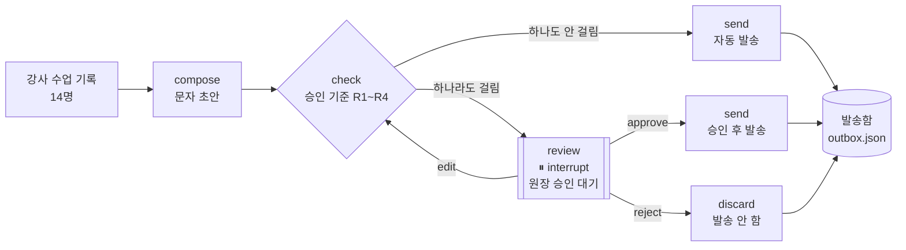

# GrowNote 발송 승인실 — HITL 파이프라인 보고서

## 1. 문제 정의

GrowNote는 강사가 수업 기록을 남기면 AI가 학부모 피드백 문자를 써 주는 학원용 앱입니다. 실제로 운영해 보니 위험은 문장 솜씨보다 **강사 메모에 섞여 들어온 정보**에서 나왔습니다.

- "지호랑 짝을 지어…" → 다른 학생 이름이 학부모에게 그대로 나감
- "302호 창가 자리로 옮겼습니다" → 강의실 번호와 자리 이동이 설명 없이 통보됨
- "지난번보다 좋아졌어요" → 이전 기록이 없는데 성장 이야기를 지어냄
- "환불 문의를 하셨습니다" → 상담이 필요한 일이 자동 문자로 나감

그렇다고 모든 문자를 원장이 하나하나 검토하면 자동화하는 의미가 없습니다. 그래서 **위험한 문자만 내보내기 직전에 멈추고, 나머지는 자동으로 보내는** 파이프라인을 만들었습니다.

## 2. 구조도

| 구성 | 파일 | 역할 |
|---|---|---|
| 초안 작성 | `compose.py` | 템플릿으로 문자 생성 (API 키 불필요, LLM으로 교체 가능) |
| 승인 기준 | `rules.py` | 계산 가능한 기준 4개, 걸린 부분(match)까지 반환 |
| 그래프 | `graph.py` | LangGraph `StateGraph` + `interrupt()` + `SqliteSaver` |
| 웹 데모 | `app.py` | Streamlit: 일괄 실행 / 승인 대기함 / 발송함·기록 / 기준 |

**HITL 구현 핵심**
- `review` 노드에서 `interrupt()`를 호출하면 그래프가 그 자리에서 멈춥니다. 상태는 `SqliteSaver` 체크포인트(학생 1명 = thread 1개)에 저장됩니다.
- 원장이 버튼을 누르면 `Command(resume={"action": ...})`로 **멈춘 자리에서 이어서** 실행합니다.
- **수정 후 승인**한 문장은 바로 보내지 않고 `check`로 되돌아가 같은 기준으로 다시 검사합니다. 사람이 고친 문장도 검사를 거칩니다.
- 체크포인트가 파일에 남기 때문에 화면을 새로고침하거나 앱을 다시 켜도 대기 건이 남아 있습니다(`test_survives_restart`).
- 발송함은 thread_id 기준으로 한 번만 기록합니다. 다시 실행해도 같은 문자가 두 번 나가지 않습니다.

## 3. 승인 기준

모든 기준은 **코드로 계산**합니다. LLM에게 "위험해 보이나?"라고 묻지 않기 때문에 같은 입력이면 항상 같은 판정이 나오고, 왜 걸렸는지 정확한 문자열로 보여 줄 수 있습니다.

| 기준 | 계산 방법 | 막으려는 위험 | 임계값을 이렇게 정한 이유 |
|---|---|---|---|
| **R1 다른 학생 이름** | 학원 학생 명단의 성+이름과 이름(2글자)을 본문과 문자열 대조. 본인 이름은 제외 | 다른 학생의 개인정보 유출 | 1건이라도 유출이므로 임계값 없이 0건이어야 통과. 학부모 문자에서는 성을 빼고 이름만 부르는 경우가 많아 이름만도 함께 검사 |
| **R2 강의실·교재 쪽수** | 정규식 `\d+호(실)?`, `\d+(쪽\|페이지)\|p.\d+` | 내부 운영 정보 노출. 쪽수만 보고 진도를 오해 | GrowNote 설계 명세 P7 "강의실 번호·교재 페이지 번호는 학부모 메시지에 넣지 않는다"를 그대로 코드로 옮김 |
| **R3 근거 없는 비교** | 비교 표현("지난번보다", "여전히", "좋아졌" 등)이 있는데 **이전 발송 기록이 0건** | 기록에 없는 성장 이야기를 지어내 신뢰를 잃음 | 단어만으로 막으면 정당한 비교까지 막힘. 그래서 기록이 있는 학생(윤도현, 기록 3건)의 "지난번보다"는 통과시킴 |
| **R4 민감 주제·결석** | 민감 단어(환불, 퇴원, 자리, 다툼 등) 매칭 **또는** 이번 달 결석 3회 이상 | 상담이 필요한 일이 자동 문자로 나가 갈등이 커짐 | 결석 3회는 주 2회 수업 기준으로 한 달의 약 1/3. 이 정도면 원장이 사정을 먼저 확인할 필요가 있음 |

## 4. 실행 결과

`python run_demo.py`로 재현할 수 있습니다(API 호출 없음). 학생 14명은 모두 가상 데이터이고, 위험 사례 6건은 일부러 심어 두었습니다.

**1단계: 일괄 실행 → 자동 발송 8건, 승인 대기 6건**

| 학생 | 걸린 기준 | 걸린 부분 |
|---|---|---|
| 이하윤 | R1 다른 학생 이름 | `지호` |
| 최예린 | R2 강의실·교재 쪽수 | `45쪽`, `52쪽` |
| 정민재 | R2, R4 | `302호`, `자리` |
| 강다은 | R3 근거 없는 비교 | `지난번보다`, `좋아졌` |
| 한소율 | R4 민감 주제·결석 | `결석은 3회` |
| 임채원 | R4 민감 주제·결석 | `환불` |

윤도현의 "지난번보다 실수가 줄었습니다"는 이전 기록이 3건 있어서 **걸리지 않고 자동 발송**됐습니다. R3가 단어 검색이 아니라 기록 여부까지 계산한다는 점을 보여 주는 사례입니다.

**2단계: 원장 결정 → 그래프 재개**

| 학생 | 결정 | 재개 후 상태 | 비고 |
|---|---|---|---|
| 이하윤 | 수정 후 승인 | 발송 | "지호랑" → "친구와" |
| 최예린 | 수정 후 승인 | **다시 대기** | 45쪽만 지우고 `52쪽`이 남아 재검사에서 걸림 |
| 최예린 | 수정 후 승인 | 발송 | 쪽수 문장을 고친 뒤 통과 |
| 정민재 | 반려 | 발송 안 함 | 자리 이동은 전화로 따로 안내 |
| 강다은 | 수정 후 승인 | 발송 | 비교 표현을 오늘 관찰 사실로 바꿈 |
| 한소율 | 그대로 승인 | 발송 | 결석 사실을 확인한 뒤 원장 판단으로 발송 |
| 임채원 | 반려 | 발송 안 함 | 환불 건은 문자 대신 상담 |

**3단계: 최종 결과**: 자동 발송 8 · 승인 후 발송 4 · 반려 2 · 대기 0. 원장이 검토한 건 14건 중 6건(43%)입니다.

전체 결과와 최종 본문은 [results/demo_result.md](results/demo_result.md)에 있습니다.

**테스트**: `python -m unittest discover -s tests`를 실행하면 10개가 모두 통과합니다. 규칙 판정, 자동/대기 분기, 승인 후 재개, 수정 후 재검사, 반려 시 미발송, 재시작 후 대기 유지, 그리고 Streamlit `AppTest`로 웹 화면에서 실행 버튼과 승인 버튼을 누르는 흐름까지 검사합니다.

## 5. 한계와 다음 단계

- **초안은 템플릿**입니다. API 크레딧을 아끼고 시연 결과를 고정하려는 선택입니다. LLM으로 바꿀 때는 `compose_draft`만 교체하면 되고, 기준 검사는 그대로 적용됩니다. 오히려 LLM이 지어낸 문장(R3)을 잡는 역할이 더 중요해집니다.
- R1은 학생 명단에 있는 이름만 잡습니다. 형제나 다른 학원 친구 이름은 잡지 못합니다.
- R4의 민감 단어 목록은 수작업입니다. 운영하면서 반려된 문자를 모아 목록을 늘리는 방식이 현실적입니다.
- 실제 카카오 발송은 연결하지 않았습니다. 연결할 때도 `send` 노드 하나만 바꾸면 되고, 승인되지 않은 경로에서는 발송 코드가 호출되지 않습니다.
